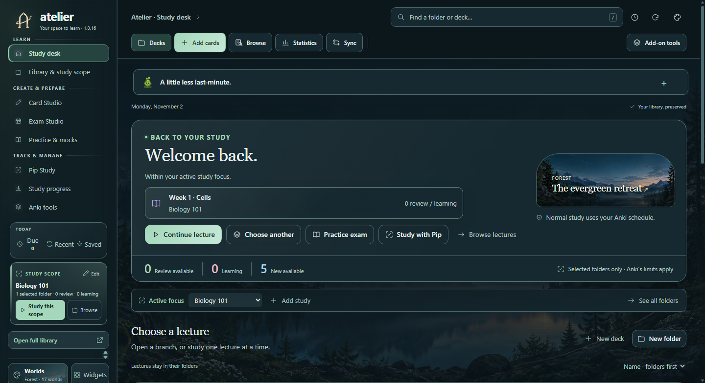
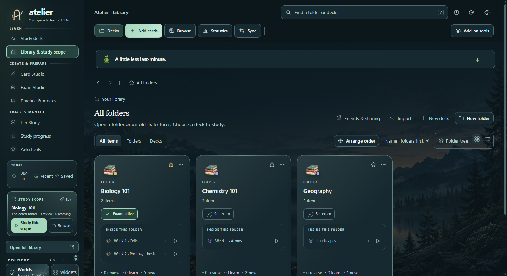
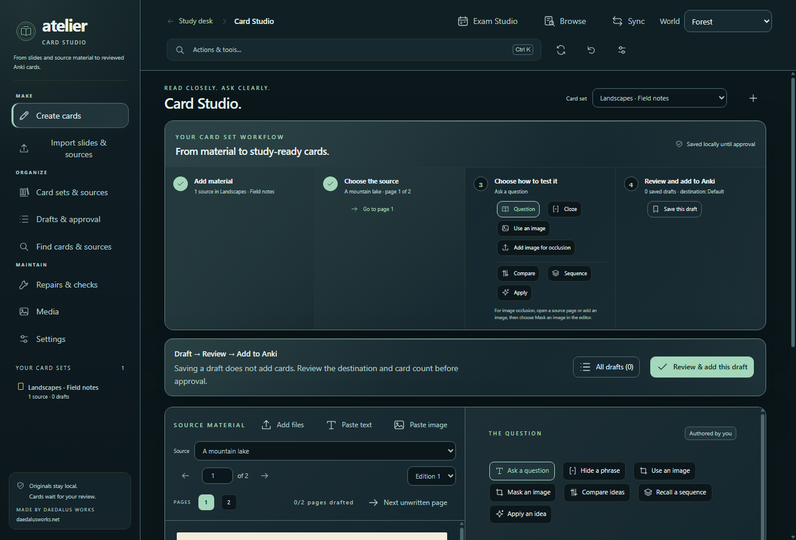
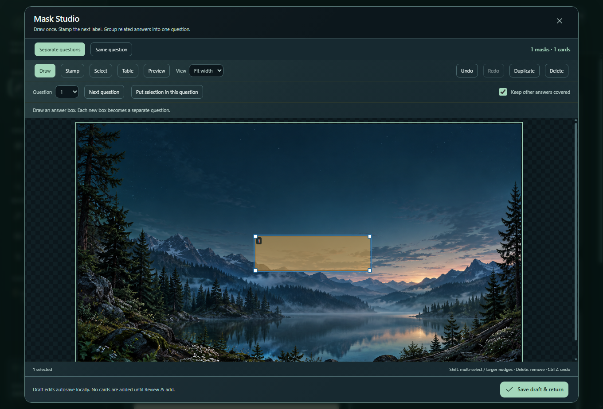
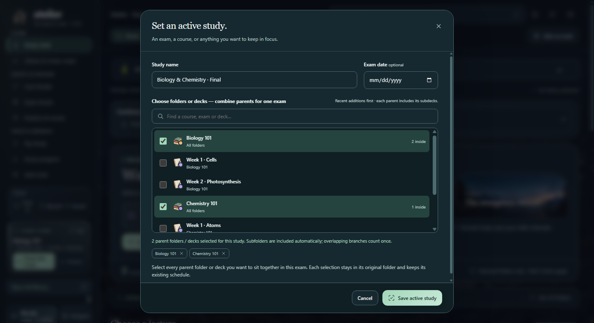
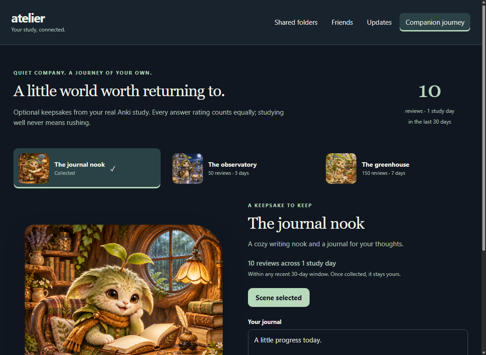

Atelier brings your courses, card creation and study together inside Anki.

## Your courses, opened up

Browse a whole course and its lectures on the main screen. Choose folder icons and colors, keep your own course and lecture order, and pin the material you use most.

## Choose exactly what to study

Continue one lecture, study a whole folder, or combine several parent folders for an exam. Cards stay in their original decks. Normal review uses Anki’s scheduler and daily limits.

## Make cards beside your material

Organize slides, PDFs, images and notes into source projects. Create questions, clozes and image-occlusion masks beside the source, then review drafts and choose their Anki destination. Your usual Anki editor remains available for other note types and tools.

## Prepare, practise and pick up where you left off

Exam Studio includes practice and mock sessions, saved unfinished work, self-marking and results. Readiness indicators are planning estimates, not predictions of an exam grade.

## A space that feels like yours

Choose from 17 scenic worlds, 24 illustrated folder icons and six folder colors. Built-in widgets, a study clock and an optional guided tour help you settle in. Reduced motion is respected. Onigiri rewards can appear on the Study desk when Onigiri is installed separately.

## A companion journey

Your real Anki reviews can unlock three keepsakes: a journal nook for reflection, an observatory showing study activity, and a greenhouse linked to your selected study focus. Collected keepsakes stay collected. Core tools and themes are always available; speed and answer ratings do not earn extra rewards.

## Sharing

Send a course or deck through Anki’s normal package export. The Friends window also opens with Atelier visuals turned off. Online invitations and attached-folder updates require a separately configured service; this download does not include an active hosted Friends service.

## Installation and compatibility

Install Atelier through Anki’s Add-ons manager and restart Anki. For a downloaded file, use Tools → Add-ons → Install from file. Declared minimum: Anki desktop 25.09.5. Native functional checks use Anki 26.09.3 on Windows in offscreen test profiles. macOS/Linux native use, hardware controllers and every third-party add-on combination are not certified. This add-on does not run inside AnkiMobile, AnkiDroid or the AnkiWeb study interface.

## Your work and backup

Core card creation needs no AI service. Optional provider assistance needs configuration and approval before text is sent. Back up your collection and Atelier’s source projects, drafts, exam records and settings; Anki Sync does not include every add-on file.

## Screenshots

Actual Anki/Qt webviews with example data. Captured offscreen; native window borders are excluded. These are working interfaces, not generated mockups.

## Support and source

[Report an issue](https://github.com/AAAAAAwd899/Atelier/issues) · [Source code](https://github.com/AAAAAAwd899/Atelier)

Atelier source is MIT-licensed; bundled libraries retain their own notices.
